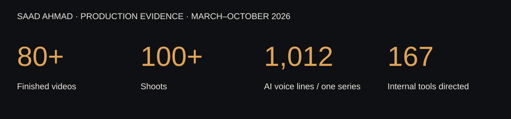

# Saad Ahmad: AI-assisted media production

**AI Automation & Workflows | Content and Media Producer | UAE 🇦🇪**

I produce video, photo and training content, and I design AI-assisted workflows that make that production faster and more consistent. I direct AI coding agents (Claude Code and Codex) to build the tooling, and I review and approve every output against brand, accuracy and privacy standards.

**My CV:** [experience, education and earlier work](CV.md) · **What I can do:** [capabilities](CAPABILITIES.md)

---

## By the numbers (May–October 2026)

| Training | Events and brand | Photo and writing |
|---|---|---|
| 35 desktop training videos | 13 event films and recaps | 16 photo sets |
| 7 phone-app training videos | 5 leadership interviews | 35 training scripts |
| 10 software how-to and explainer videos | 7 social and occasion videos | |
| | 2 corporate films | |

Totals across all my work; no figure stands for a named project, client or person.

---

## Selected work (results, not recipes)

| Project | What it does | Result |
|---|---|---|
| **Market Brief agent** | Turns verified market data into a short, voiced, charted video | Weekly brief ready by morning, every number traced to a source |
| **Automated YouTube channel** | A history channel produced end to end by an AI pipeline with quality gates | Daily uploads with human review before publishing |
| **AI training-video system** | Screen recordings turned into consistent training videos with captions and voice-over | 50+ training videos in six months |
| **Code-rendered motion graphics** | Brand-consistent animated videos built from code | Fast, repeatable, on-brand output |
| **AI With Saad** | My public channel teaching AI tools and workflows | [Free setup guides](https://github.com/saadahmadofficial1/ai-with-saad) for every tool I cover |

## How I work

- **Human in the loop.** AI does the heavy lifting; I set the creative bar and approve every release.
- **Facts first.** Numbers, names and claims are checked against sources before anything is published.
- **Privacy by default.** Client, company and personal data never leave private systems. This page shows outcomes only.
- **Two-agent workflow.** One AI builds, another reviews, with shared memory so nothing is lost between sessions.

---

**Work with me / follow along:** [LinkedIn](https://linkedin.com/in/saadahmadofficial1) · [Instagram @ai.with.saad](https://www.instagram.com/ai.with.saad/) · [all my projects](https://github.com/saadahmadofficial1)

Methods, tools and style systems are kept private. Happy to walk through them in a call.
